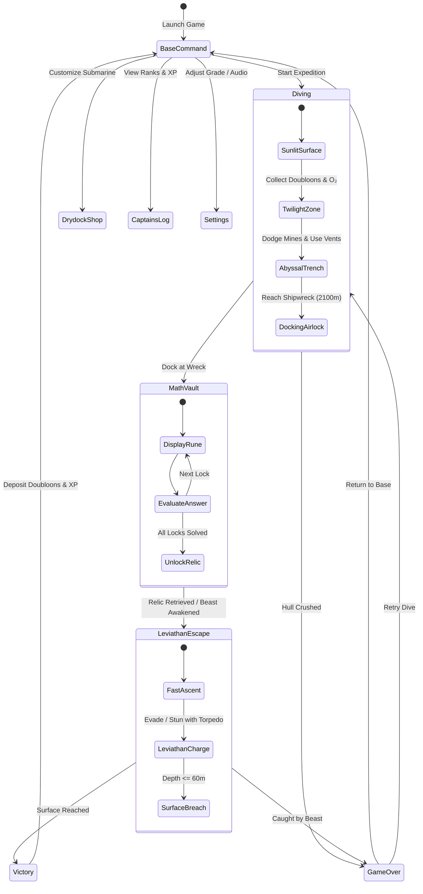

# ⚓ Abyssal Vault: The Sunken Treasure
### *Comprehensive Game Overview, Mechanics, and Architecture Guide*

---

## 🌊 1. Executive Summary

**Abyssal Vault: The Sunken Treasure** is a retro pixel-art browser arcade and educational expedition game. Players captain an explorer submarine diving into the oceanic abyss to locate legendary sunken vessels, crack ancient mathematical security ciphers to retrieve lost relics, and execute a high-speed ascent to the surface while evading the awakened **Abyssal Leviathan**.

The game blends arcade action mechanics (maneuvering, buoyancy, boost management, sonar pings, and torpedo combat) with curriculum-aligned mathematics (Grades 1 through 6+) and meta-progression (doubloon economy, cosmetic skins, and an 8-tier rank ladder).



---

## 🧭 2. The Three Gameplay Phases

### Phase 1: The Ocean Descent (0m to 2,100m)
The player pilots their submarine through three distinct underwater zones:
1. **The Sunlit Zone (0m – 500m)**: Bright cyan waters pierced by sunbeams, teeming with colorful reef fish. Serves as the introductory navigation layer.
2. **The Twilight Zone (500m – 1,400m)**: Dark sapphire waters inhabited by bioluminescent jellyfish and anchored naval mines with blinking red proximity sensors.
3. **The Abyssal Trench (1,400m – 2,260m)**: Pitch-black environment where navigation relies on the submarine's forward searchlights and active sonar pings. Home to deep-sea anglerfish and thermal caverns.

#### 🫧 Oxygen Restoration Mechanics
Submarines consume oxygen steadily during descent. Players have three independent methods to restore life support:
- **Hydrothermal Oxygen Vents**: 4 geothermal fissures positioned along cavern shelves (at 460m, 920m, 1,400m, and 1,880m). Entering their rising bubble stream recharges oxygen at **+50%/second** accompanied by visual alerts (`🫧 O₂ RECHARGING...`).
- **Floating O₂ Canisters**: Pressurized cylinders scattered frequently throughout vertical dive lanes.
- **Surface Aeration**: Ascending back to shallow waters (depth $\le 90\text{m}$) automatically refills the tanks.

#### 🪨 Solid Cavern Terrain & Naval Mines
- **Impassable Cavern Walls & Blocks**: Cavern rocks and overhangs are solid geometric barriers using minimum-penetration AABB physics. The submarine cannot pass or phase through rock blocks; impacts cause hull collision sparks, minor damage, and bounce velocity reflection.
- **High-Yield Naval Mines**: Anchored naval mines with blinking red warning sensors deal **50 HP damage (2x original lethal damage)** and produce a powerful explosive blast wave that knocks the submarine back. Two direct mine hits will breach the hull and trigger a hull implosion.

---

### Phase 2: The Sunken Vault (The Math Challenge)
Docking at the seafloor wreck transitions gameplay into an interactive cipher terminal. The player is presented with $n$ math problems generated dynamically according to the chosen **Grade Level**.

- **Immediate Question Failure**: Any question answered incorrectly or missed is immediately failed (marked with a red `✖`). There are no retries on a missed question.
- **Pass Requirement ($n - 1$ Minimum)**: The player must answer at least $n - 1$ questions correctly out of $n$ total questions to unlock the treasure. A maximum of **1 miss** is allowed.
- **Vault Lockdown on Failure**: Missing 2 or more questions immediately triggers a security lockdown. The treasure remains sealed, and the alarm sounds, awakening the Leviathan for an emergency retreat to the surface without the relic.
- **Input Modalities**: Mouse click, touchscreen taps, or keyboard numeric hotkeys (`1`, `2`, `3`, `4`).
- **Assistance System**: An optional **"Need a Hint?"** scroll provides conceptual hints. Correct answers are displayed upon missing a question for educational review.

---

### Phase 3: The Leviathan Escape (Ascent)
Unlocking the vault triggers a low-frequency seafloor earthquake and an ominous roar as the **Abyssal Leviathan** awakens from the trench.

- **The Predator**: A 12-segment articulated sea serpent with glowing crimson eyes, razor fangs, and dynamic jaw snapping.
- **Stalking & Charging**: The monster follows the submarine upward, periodically entering a rage state (indicated by audio roars and visual red glowing scales) before executing a high-speed lunge.
- **Evasion Tactics**:
  - **Speed Boost**: Hold `Shift` to engage thruster afterburners.
  - **Sonic Torpedoes**: Fire with `F` or `Space` to detonate against the beast, stunning it and halting its pursuit for several seconds.
  - **Cavern Navigation**: Weaving through narrow rock spires forces the Leviathan to collide with walls, slowing its ascent.
- **Victory**: Reaching the surface water boundary (depth $\le 65\text{m}$) completes the expedition.

---

## 🚢 3. Shipwreck Variations & Relics

Players can select their expedition destination from Base Command:

| Shipwreck Target | Era / Archetype | Seafloor Visuals | Salvaged Relic & Vault |
| :--- | :--- | :--- | :--- |
| **The Black Barnacle** | 17th Century Pirate Galleon | Rotten wooden timbers, broken mast with yardarm, tattered sails with Jolly Roger, cannon ports, swaying sea kelp | **The Heart of the Sea**<br>*(Cursed Iron-Banded Treasure Chest)* |
| **R.M.S. Titanic** | 1912 Luxury Ocean Liner | Split riveted steel hull, black & burgundy paint, fallen ochre funnels with black soot rims, rusted anchor chains | **The Heart of the Ocean Diamond**<br>*(The Purser's Office Heavy Steel Safe)* |
| **B-17 Flying Fortress** | WWII Long-Range Patrol Bomber | Olive-drab aluminum fuselage, greenhouse cockpit with cracked glass, swept wings, radial engines with bent propellers | **Top Secret Flight Recorder**<br>*(Armored Military Cockpit Lockbox)* |

---

## 📐 4. Educational Math Curriculum Engine

The math engine generates problems on the fly with randomized distractors based on standardized elementary and middle school mathematics curricula:

```
Grade 1 ──► Addition & Subtraction within 20, Missing Addends (e.g. 7 + ? = 15)
Grade 2 ──► 2-Digit Addition/Subtraction, Skip Counting Sequences (e.g. 5, 10, 15, ?)
Grade 3 ──► Times Tables (0-10), Clean Division, 3-Digit Addition
Grade 4 ──► Multi-Digit Multiplication, Division with Factors, Order of Operations
Grade 5 ──► Decimals (e.g. 3.4 + 2.8), Percentages (e.g. 25% of 80), Grouped PEMDAS
Grade 6+ ─► Negative Integers, Pre-Algebra (e.g. 3x + 4 = 19), Exponents (e.g. 4² + 5)
```

### Grade Level Breakdown

| Grade | Primary Focus | Problem Formats | Example Problem |
| :---: | :--- | :--- | :--- |
| **1** | Basic facts to 20 | $a + b$, $a - b$, $a + \_ = c$ | `$8 + 6 = ?$`, `$14 - 9 = ?$`, `$5 + ? = 12$` |
| **2** | 2-digit operations & patterns | $2\text{D} \pm 2\text{D}$, skip counting | `$34 + 28 = ?$`, `$72 - 35 = ?$`, `$6, 12, 18, ?$` |
| **3** | Multiplication & division foundations | $a \times b$ (up to $10$), $c \div a$, $3\text{D} + 3\text{D}$ | `$7 \times 8 = ?$`, `$54 \div 6 = ?$`, `$245 + 130 = ?$` |
| **4** | Multi-digit & order of operations | $2\text{D} \times 1\text{D}$, basic PEMDAS, factor division | `$16 \times 7 = ?$`, `$4 \times 5 + 12 = ?$`, `$96 \div 8 = ?$` |
| **5** | Decimals, percentages, fractions | Decimal addition, benchmark %, parentheses | `$4.6 + 3.7 = ?$`, `$25\% \text{ of } 60 = ?$`, `$(5 + 4) \times 6 = ?$` |
| **6+**| Pre-algebra & signed numbers | Integer arithmetic, linear solve, powers | `$-8 + 14 = ?$`, `$3x + 7 = 25 \rightarrow x = ?$`, `$3^3 + 8 = ?$` |

---

## 🎖️ 5. Progression, Ranks & Cosmetics Economy

### Persistent Economy (Doubloon Wallet)
- Doubloons gathered during dives are permanently banked into `localStorage` upon surfacing.
- Currency is spent in the **Drydock Shop** for visual customizations.

### The Drydock Cosmetics Catalog

#### Hull Paint Jobs
- **Classic Nautilus** *(Default, Free)*: Traditional brass rivets and ocean yellow hull.
- **Stealth Spectre** *(100 Doubloons)*: Matte midnight onyx with electric cyan trim.
- **Coral Explorer** *(200 Doubloons)*: Vibrant reef aqua with magenta accents.
- **Volcanic Magma** *(350 Doubloons)*: Basalt black with molten lava orange core.
- **24K Sovereign** *(600 Doubloons)*: Gleaming solid gold plating.

#### Forward Searchlight Colors
- **Warm Halogen** *(Default, Free)*: Classic warm incandescent beam.
- **Bioluminescent Cyan** *(60 Doubloons)*: Deep-sea glowing azure beam.
- **Emerald Sonar** *(80 Doubloons)*: High-visibility electric green beam.
- **Ultraviolet Neon** *(120 Doubloons)*: Fluorescent violet searchlight.

### Captain Rank Ladder & Scoring Formula
Completing an expedition calculates earned **Expedition XP** (paced so ranking up requires multiple successful expeditions):

$$\text{Earned XP} = \Big(\text{Base } (180) + \text{Accuracy Bonus } (0\text{--}120) + 0.5 \times \text{Doubloons} + \text{Health Bonus } (0\text{--}60) + \text{Speed Bonus } (15\text{--}80)\Big) \times M_{\text{grade}}$$

Where $M_{\text{grade}}$ rewards higher difficulty:
- **Grade 1**: $1.0\times$
- **Grade 2**: $1.15\times$
- **Grade 3**: $1.3\times$
- **Grade 4**: $1.5\times$
- **Grade 5**: $1.7\times$
- **Grade 6+**: $2.0\times$

#### The 8 Rank Tiers
1. `🪣` **Cabin Boy** (0 XP)
2. `🤿` **Deckhand Diver** (1,000 XP)
3. `⚓` **Deep Sea Apprentice** (2,600 XP)
4. `🧭` **Oceanic Explorer** (5,200 XP)
5. `🗺️` **Trench Navigator** (9,000 XP)
6. `🎖️` **Submarine Commander** (15,000 XP)
7. `👑` **Abyssal Master** (23,000 XP)
8. `🔱` **Legendary Sea Lord** (34,000+ XP)

---

## 🕹️ 6. Controls & Accessibility

| Action | Primary Keyboard | Secondary / Alternative | Touch / Mobile Screen |
| :--- | :--- | :--- | :--- |
| **Move / Steer** | `W` `A` `S` `D` | `↑` `←` `↓` `→` Arrow Keys | On-Screen D-Pad |
| **Engine Speed Boost** | `Shift` (Hold) | `ShiftRight` | `⚡ BOOST` Button |
| **Sonar Echo Ping** | `Spacebar` | — | `📡 SONAR` Button |
| **Fire Sonic Torpedo**| `F` | `E` | `🚀 FIRE` Button |
| **Select Cipher Option**| `1`, `2`, `3`, `4` | Mouse Click | Tap Option Card |
| **Return to Base Command**| `Esc` / Click HUD `🏠` | — | Tap `🏠` in Top HUD |

---

## 💻 7. Technical Architecture & File Directory

The project is built entirely on native web standards (HTML5 Canvas 2D, CSS3, Vanilla ES6 Modules, and the Web Audio API). It operates 100% offline without third-party frameworks, build pipelines, or external audio asset dependencies.

```
jj-game-prototype/
├── index.html           # Main DOM structure, canvas, and UI overlay modals
├── style.css            # Retro pixel typography, layout, HUD badges, animations
├── README.md            # Quickstart guide and control reference
├── GAME_DESCRIPTION.md # Complete game design, math breakdown, and architecture guide
└── js/
    ├── main.js          # Central game loop, camera, input, state machine coordinator
    ├── audio.js         # Web Audio API procedural 8-bit sound effects & chiptune synth
    ├── mathEngine.js    # Grade-tailored math problem and distractor generation
    ├── progression.js   # Persistent Doubloon wallet, cosmetics shop, rank XP engine
    ├── sprites.js       # 2D canvas procedural pixel art renderer (sub, ships, beast)
    ├── submarine.js     # Player physics, buoyancy, headlights, damage, propulsion
    ├── monster.js       # Segmented sea monster AI, charge attack states, stun logic
    ├── world.js         # Ocean depth layers, hydrothermal vents, caverns, mines, loot
    ├── mathVault.js     # Treasure chest and safe cipher puzzle interface
    └── settings.js      # Player preferences (grade level, volume, problem count)
```

### Audio Synthesis Implementation
All sound effects and dynamic background themes are generated procedurally through the browser's native `AudioContext`:
- **Submarine Sonar Ping**: Pure dual-sine oscillator sweep from 1,400 Hz to 1,100 Hz with exponential gain decay.
- **Engine Churn & Bubble Vents**: Random-frequency sine oscillators (300 Hz – 500 Hz) with rapid envelope modulation.
- **Underwater Explosions**: Procedurally generated white-noise buffer passed through an exponentially declining low-pass biquad filter (800 Hz down to 80 Hz).
- **The Leviathan Roar**: Dual detuned sawtooth and triangle oscillators (70 Hz – 124 Hz) routed through a resonant low-pass filter with peak sweep.
- **Dynamic Chiptune Tracks**: Multi-track 16th-note procedural sequences for ambient descent (calm triangle arpeggios), contemplative puzzle contemplation, and high-tempo minor-key chase music (144 BPM sawtooth driving bassline).
